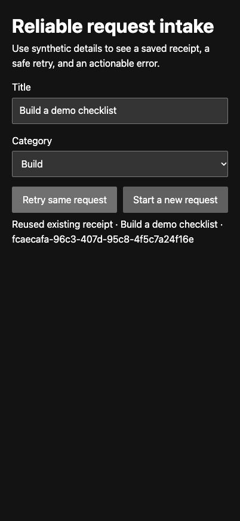

# Reliable request intake

A local demo of how a small API handles validation, retries and concurrent saves. It uses synthetic requests and an isolated PostgreSQL database.

## Run locally

Requires Node.js 22. Run these commands from this directory in a shell you can leave open for the demo.

```sh
npm ci
npm start
```

Open [the local demo](http://localhost:3216). From another shell, run `npm test` from this directory to exercise the HTTP API and database. Stop the server with Ctrl+C.

## Verified behavior

The HTTP check confirms that eight simultaneous requests with one fresh key produce one creation and seven replies with the same receipt. It also tests two competing sets of details sent with the same key. One set keeps the receipt and the other receives a conflict. A one-character title receives a validation error.



## Two-minute walkthrough

1. Save the example request. Point out the receipt ID and the action changing to **Retry same request**.
2. Reload the same tab and retry. The original fields and key are restored, and the same receipt ID returns. Explain how the database's unique key prevents duplicate rows when two requests arrive together.
3. Change the title and retry. The API asks you to restore the original details or start a new request. Select **Start a new request**, enter a one-character title, and save to see the validation message. Correct the title and save again.
4. Run `npm test`. It checks the statuses and confirms eight simultaneous HTTP submissions for one fresh key receive one receipt.

## API contract

`POST /api/requests` accepts JSON with a UUIDv4 `key`, a single-line `title` of 3–100 characters, and a `category` of `build`, `repair`, or `research`. It returns the saved ID, title, category, timestamp and retry status. A new save returns 201. Identical replay returns 200 with the original ID and timestamp. Changed details under an existing key return 409. Invalid fields return 422 with a correction to make.

The browser saves the key and original fields in the tab’s session before sending. Reload the same tab to recover an unconfirmed save, or choose **Start a new request** when you intend to create another record. The database runs as a single embedded PostgreSQL instance and persists under `.demo-db/`. The HTTP server binds to loopback. The demo has no account system or production deployment. Use synthetic data only. [PGlite local storage](https://pglite.dev/docs/filesystems)
